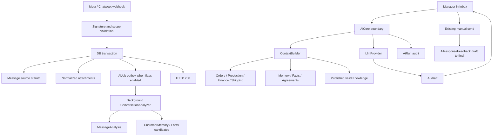

# YOleotard CRM Intelligence Layer

## Audit before implementation

The project is a pnpm TypeScript monorepo: Next.js web, NestJS REST API, Prisma/PostgreSQL 16, Redis 7 and Docker Compose. It is a modular monolith.

Before this change, `Conversation` and `Message` already persisted Facebook, Instagram, WhatsApp/Chatwoot and manual drafts. `Message` had direction, status, content, external ID, metadata, author and timestamp. Meta normalization preserved attachment descriptors in JSON metadata; local outbound uploads used `CommunicationAttachment`. Missing foundations were durable raw webhook replay data, normalized inbound attachments, reply/language/type/analysis metadata, structured intelligence records, an AI run journal, prompt versions, a context boundary and draft-to-final feedback.

The existing AI assistant called OpenAI directly from `AiAssistantService`, built a small client/order context, and wrote aggregate `AuditLog` entries. Redis existed for infrastructure health/rate limiting, but there was no job queue. Settings already used `AppSetting`, encrypted secrets and an AI tab. Therefore the implementation extends these patterns rather than adding a parallel customer, order or settings subsystem.

## Architecture



## Source-of-truth boundaries

- Orders, payments, production and shipping: existing CRM tables/services only.
- Customer statements: immutable messages and sourced extracted memory/facts.
- Confirmed conditions: only `VERIFIED` `Agreement` records with both the customer message and a non-null staff confirmation message may enter AI grounding context.
- Company rules: published, non-expired `KnowledgeItem` current versions.
- Analyses and summaries: replaceable derived data; never delete source messages.

## Data foundation

`Message` is extended backward-safely with normalized text, language, message type, reply relation, sent/received timestamps, raw payload and processing version. `MessageAttachment` normalizes remote inbound media while the existing `CommunicationAttachment` remains the upload reservation/storage record for compatibility.

New derived/business-intelligence tables:

- `MessageAnalysis`
- `CustomerMemory` with active/verified/superseded/rejected lifecycle and provenance
- `ConversationFact`
- `Agreement`
- `KnowledgeCategory`, `KnowledgeItem`, `KnowledgeVersion`
- `AiPrompt`, `AiRun`, `AiResponseFeedback`
- `ConversationSummary` (P1 producer not enabled)
- `AiModeOverride`
- `AiJob` transactional outbox

## Processing and modes

`AI_ENABLED` and `AI_MESSAGE_ANALYSIS_ENABLED` must both be true to enqueue new analysis work. The worker is in-process for the initial low-volume phase and claims jobs with PostgreSQL `FOR UPDATE SKIP LOCKED`. Moving the worker to BullMQ later does not change producers or intelligence services.

Mode precedence is conversation, customer, channel, global. Global behavior is `OFF` when AI is disabled and otherwise `ASSIST`. `AUTO_SAFE`, `AGENT` and `AUTONOMOUS` exist only as future configuration values; no automatic client send is implemented.

Feature flags:

```env
AI_ENABLED=false
AI_MESSAGE_ANALYSIS_ENABLED=false
AI_MEMORY_ENABLED=false
AI_KNOWLEDGE_ENABLED=false
AI_DRAFTS_ENABLED=true
AI_AUTO_REPLY_ENABLED=false
```

## Context and security

`ContextBuilderService` is the only context assembly boundary. It selects explicit safe fields and excludes application settings, encrypted credentials, Meta tokens, passwords and raw payloads. Raw payload is retained only for authorised replay/audit and is never included automatically in prompts.

`ToolService` defaults unknown tools to high risk. Tools do not receive SQL access and parameters must be validated by the existing DTO/service layer. P0 performs no autonomous tool execution.

## ASSIST workflow now

1. Webhook validates and saves the message normally.
2. With flags enabled, the same transaction creates `AiJob`.
3. The worker creates versioned language/intent analysis without delaying Meta.
4. Manager selects messages and requests a draft.
5. ContextBuilder adds current CRM state, active sourced intelligence and valid knowledge.
6. The provider call is recorded as `AiRun`; the draft is stored in `AiResponseFeedback`.
7. Manager may edit/translate and explicitly sends through the existing Meta path.
8. Successful send links final text and sent message to feedback.

No real paid provider is used in tests.

## Semantic retrieval

pgvector is intentionally P1. Production currently uses `postgres:16-alpine`, which does not include the extension. Enabling it requires a reviewed PostgreSQL image/extension migration and backup/restore drill. SQL text/version records remain canonical; embeddings will be derived records with entity ID, provider-neutral model metadata and content hash.

## Deployment and migration

Apply only through Prisma:

```bash
pnpm db:generate
pnpm db:deploy
```

Migration: `20260830120000_ai_intelligence_foundation`. It adds nullable/defaulted columns and new tables; it does not delete or rewrite existing messages.

## Intentional next steps

- P1: knowledge/memory/history UI, embedding records and pgvector deployment decision, summary producer, robust retry/dead-letter scheduling, prompt CRUD and reference-dataset eval runner.
- P2: approved tool execution and stateful workflows only after evaluation evidence.
- Not enabled: automatic replies, autonomous price/payment/deadline changes, refunds, deletion, multi-agent framework or fine-tuning.
