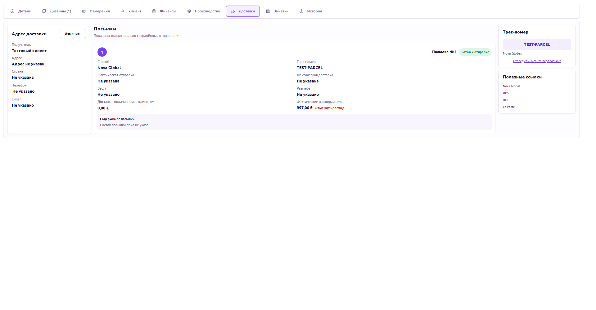
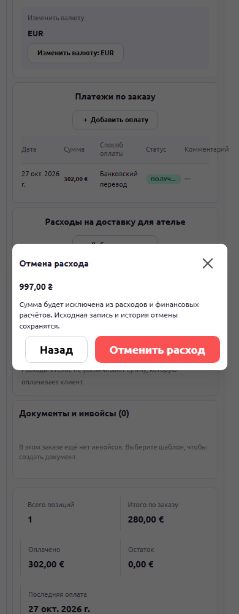

# Order expense cancellation — 2026-10-27

Status: PASS_LOCAL_ONLY, READY_FOR_OWNER_REVIEW. NOT DEPLOYED.

## Scope

Orders page only, expanded order Delivery and Finance tabs. The owner explicitly
clarified this placement. Customer payments and agreed order price are unaffected.

- Delivery: cancellation action next to the saved linked atelier expense. On
  mobile the action is compact with an accessible label and a confirmation dialog.
- Finance: cancellation action in the status cell for each exact expense row.
- Confirmation shows amount/currency. DELETE archives the existing ledger entry;
  history/audit remain. Linked parcel cost becomes zero; subsequent financial
  reads exclude archived expenses through existing rules.
- Two independent equal-amount entries remain independent. No automatic duplicate
  removal or migration of historical amounts.
- No fake ledger entry is created for a legacy parcel without atelierExpense.
- Original create-expense callback unchanged. Cancellation alone gets a strict
  refresh callback; its committed state survives both tab unmounts. Following a
  successful DELETE, read failures retry GET only, never another cancellation.

## Compatibility

Reuses existing DELETE /finance/expenses/:id with unchanged
OWNER/ADMIN/ACCOUNTANT guards and tax-expense protection. No API, DB, tax, FX,
payment, shipping-status, provider or deployment configuration changes. Affected
runtime: new domain cancellation component, two existing order UI files and i18n.
All unrelated dirty files are preserved against .local/expense-cancellation/baseline.json.

## Verification

- Browser test first failed on missing action; actual production OrderExpandedTabs
  then passed both entry points, exact linked/standalone IDs, cancellation/back,
  server/tax refusal, refresh-only recovery across Finance->Delivery, readonly
  manager, original POST success plus failed GET (one creation), and 1920/1366/390.
- Synthetic HTTP only. No production writes or external provider calls.
- Existing backend focused tests27 PASS; business reviewer independently43 PASS.
- Final full quality gate PASS after all reviewer fixes: API1990/web671/database28, zero failures,18 opt-in skips. New browser suite explicitly executed PASS. Typecheck/API build/web build PASS.
- Review fixes: per-order committed state and mobile action overflow; separate
  strict cancellation callback preserves the creation compatibility contract.
- Independent Standards and Spec review supplement all mandatory roles.

## UI evidence

All six screenshots plus browser receipt are in docs/ui/order-expense-cancellation-2026-10-27.
Private logs/baseline/fingerprints live in .local/expense-cancellation. No Git
commit/push or deployment performed. Installed production remains0.12.0 from the
previous separately authorized release; live cancellation is intentionally unverified.

## Final reviews

Compatibility/Standards: Euclid PASS. Regression: Halley PASS (62 existing web
tests independently passed). Business/Spec: Dalton PASS (43 backend tests
independently passed). Visual: Lovelace PASS, six final screenshots inspected.
Release gatekeeper Heisenberg: PASS_LOCAL_ONLY after final quality exit0; source fingerprints unchanged.

The new UI uses only the established expense archive operation. No production
mutation was used for validation, so installed/live cancellation stays UNVERIFIED
until a separately authorized deployment and operator smoke. Version0.12.0 remains
the installed release; no new release artifact/version bump has been published.
