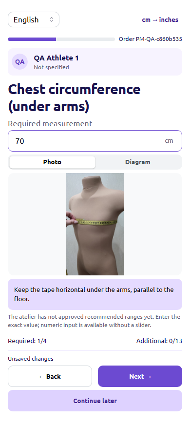
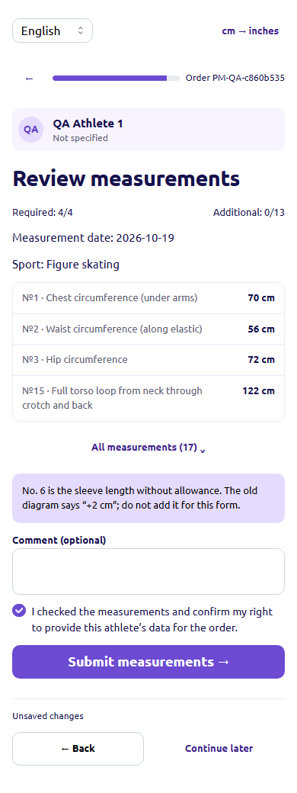

# «Измерения от родителей» — локальная проверка

Основание: утверждённое ТЗ v2, PNG и оригинальный ZIP. Владелец разрешил оба этапа
локальной реализации. Развёртывание и production-миграции не выполнялись.

## Реализовано

- Отдельные защищённые приглашения и приватные сессии родителей, отзыв, срок
  действия, одноразовое восстановление и общая пересылаемая ссылка.
- Мобильный мастер на шести языках, 17 прежних параметров, четыре обязательные
  мерки, cm/in, явное округление, исходные фото/схема и увеличение изображений.
- Автосохранение с контролем версии, предупреждение о несохранённых данных,
  явная отправка, безопасный повтор запроса и новая версия при исправлении.
- Канонические Athlete/Measurement, связь с клиентом и заказом, явное назначение
  физическим экземплярам, отдельная проверка менеджера и полный аудит.
- Версионированные утверждённые диапазоны с подтверждением каждого выхода за
  границы. До их утверждения числовой ввод работает без выдуманных норм.
- Совместимость старых мерок: nullable определение сохраняет прежний смысл №6.
  Новые PARENT_BODY_V1 используют чистую длину рукава, без автоматической ±2 см.
- Ссылку можно вставить в черновик переписки; отправки от имени менеджера нет.

## Отличия от демонстрационного PNG

ТЗ v2 требует приватность: вместо общего списка детей показываются только анкеты
текущего родителя. Общий список доступен сотрудникам CRM. До открытия защищённой
сессии форма не раскрывает данные заказа или детей. Возраст и фото необязательны;
вместо демонстрационных портретов используются реальные загруженные фото либо инициалы.

Прототип показывает примерные рекомендуемые числа. Они не перенесены как нормы
тела: диапазоны утверждаются ателье отдельно. Подпись №6 уточнена по прямому решению
владельца. Исходная таблица с прежним «+2 см» сохранена как оригинал, рядом явно
указано правило новой формы. Для №15 пояснён полный маршрут через промежность;
фото со спины показывает только часть пути.

Используются существующие Mantine и тема CRM. На небольшом экране итоговый список
сначала показывает обязательные и заполненные мерки, все 17 раскрываются отдельно.
Подсказки имеют проверенный контраст 6,03:1. Фотоинструкции исходные, без генерации
и ретуширования.

## Границы доказательств

Автоматизированные браузерные проверки используют Chromium. Проверяются мобильные
размеры и клавиатура, но это не сертификация физического iOS/Android-устройства.
Изолированный QA API использует реальные Nest-сервисы, авторизацию и PostgreSQL;
внешний Redis в HTTP-сценарии заменён явно обозначенным локальным RESP-адаптером.
Отказ реального клиента Redis дополнительно проверяется модульными тестами.
Никакие сообщения клиентам и запросы к социальным/почтовым провайдерам не отправлялись.

Самостоятельные визуальные стенды со синтетическим HTTP отделены от сквозного
сценария Next → Nest → PostgreSQL. Production-bundle QA использует отдельную
сборку с loopback rewrite. Стандартная сборка проверена отдельно с обычной
конфигурацией. Трассированный standalone-каталог на Windows не запустился из-за
EPERM на junction React; для локальной проверки production-бандлов использован
установленный Next в custom-server режиме, привязанный к 127.0.0.1. Это не
проверка Docker/Linux-образа и не развёртывание. Физические мобильные устройства
и production-прокси в этой задаче не проверялись.

## Выполненные проверки

| Проверка | Результат |
| --- | --- |
| `pnpm@11.16.0 quality:check` | PASS: тесты, TypeScript, Prisma generate, Nest и Next build |
| Обычные тесты | API 1423 PASS; web 560 PASS; database 26 PASS; opt-in пропуски указаны отдельно |
| PostgreSQL: основной сквозной набор | 9 PASS |
| PostgreSQL: отдельный регрессионный набор | 35 PASS на свежей выделенной БД; все 40 миграций применены локально |
| HTTP настоящего API | 10 PASS, включая staff-фото, Origin/CSRF, лимиты, отказ чужим сессиям и отзыв |
| Chromium: контракт публичной формы | 12 PASS, все шесть языков |
| Next → Nest → PostgreSQL | Три родителя, три разных снимка, чужие анкеты недоступны; `no-store`; ошибок JS нет |
| Действия менеджера | Реальный заказ, создание ссылки, переход в нужную переписку, сохранение существующего текста и ссылки в DRAFT; отправленных сообщений и запросов отправки нет |
| Ширины / клавиатура | 320/390/768/1366 в полном публичном сценарии; отдельный визуальный стенд — 8 ширин до 1920; Tab/Escape, focus trap/return, имитация клавиатуры 390×500 |
| `pnpm dag:test` | 45 PASS |
| `git diff --check` | PASS; исходные посторонние изменения защищены отдельным SHA256 baseline |

Обычный `pnpm test` намеренно пропускает opt-in PostgreSQL/HTTP/browser-наборы без
явного окружения; их фактические прогоны перечислены отдельно. Регрессионный
PostgreSQL-набор сохранён в репозитории и требует пустую loopback БД
`parent_measurements_regression_test`, а не рабочую базу.

Проверены гонки отправки/редактирования/отзыва/архивирования/слияния/разделения,
сбои после первых записей с полным откатом, повтор неизвестного результата,
сохранность финансов/количества/слотов/статусов, ограничения готовых и отправленных
изделий. Отдельные 148 проверок закрывают шесть старых путей обхода подтверждения
для новых parent-body мерок в начатом производстве. Старые legacy→legacy операции
сохраняют прежнее поведение.

Retention проверен на более чем 100 принятых фотографиях перед удаляемым файлом,
а также на отзыве корневой ссылки при ещё действующем дочернем приглашении.
Принятые версии и фото сохранились. Гонки настройки диапазонов и отправки
проверены с реальными блокировками PostgreSQL.

В первом production-браузерном контрактном прогоне одна немедленная проверка URL
сработала раньше hydration: серверный заголовок уже был виден, fragment ещё не
очистился. Исправлено ожидание в тесте, логика приложения не менялась; повторный
полный прогон — 12/12 PASS. Две ошибки локаторов в частном staff QA-скрипте также
исправлены в скрипте; итоговый сквозной сценарий прошёл.

Дополнительный граничный тест обнаружил, что для утверждённого диапазона 1–4 см
нижний запас ползунка мог уйти ниже технического минимума. Граница ограничена
1 см; обычный диапазон 60–85 по-прежнему даёт 57–88. Введённые значения не
обрезаются и снимки не меняются. Сначала получен падающий тест, затем 9 профильных
проверок PASS; все четыре роли отдельно одобрили эту узкую коррекцию.

## Независимая проверка

Совместимость — PASS; регрессии — PASS; бизнес-правила и безопасность — PASS;
визуальная проверка — PASS. Дополнительный `code-review`: ось Standards проверена
отдельно от оси Spec; открытых блокирующих замечаний по реализации нет.
Финальный release gate: **POST-CLAMP LOCAL ACCEPT**, блокирующих замечаний нет.
Production-гейты **NOT RUN / OUT OF SCOPE**: развёртывание и рабочая база не затронуты.

## Скриншоты реальной локальной сборки

Данные демонстрационные; приглашение в адресной строке не сохраняется. Поле
черновика переписки закрыто маской, чтобы не публиковать ссылку доступа.

- [Приветствие](parent-measurements-2026-10-19/welcome.png).
- [Мерка №1, 320 px](parent-measurements-2026-10-19/measure-1-320.png) и
  [390 px](parent-measurements-2026-10-19/measure-1-390.png).
- [Фокус ввода / уменьшенный viewport](parent-measurements-2026-10-19/keyboard-resize-390.png).
- [Проверка перед отправкой](parent-measurements-2026-10-19/summary.png).
- [Подтверждённое получение](parent-measurements-2026-10-19/success.png).
- [Измерения в настоящем заказе](parent-measurements-2026-10-19/manager-measurements.png).
- [Переписка с защищённым черновиком](parent-measurements-2026-10-19/inbox-draft-masked.png).

Эксплуатация и ограничения: [руководство](../parent-measurements.md).
