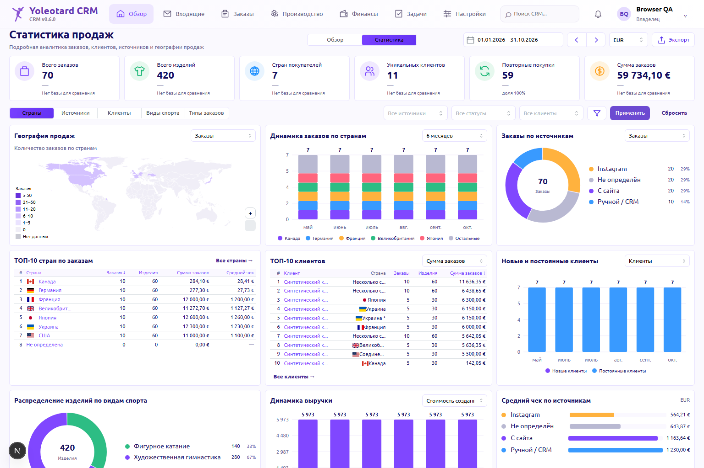

# Статистика продаж — локальная реализация, 18.10.2026

Реализован отдельный режим «Статистика» внутри «Обзора». Существующая оперативная страница сохранена. Рабочий сервер, production БД, интеграции и финансовые записи не изменялись. Миграция не нужна. Изменения не закоммичены и не развёрнуты.

Основание: [ТЗ](sales-statistics-approved-spec.md), [утверждённый PNG](sales-statistics-approved-design.png), [план архитектуры и БД](../plans/sales-statistics.md).

## Реализовано

- Переключение «Обзор / Статистика», диапазон дат, переходы между периодами, EUR/USD/UAH, обновление и CSV.
- Шесть KPI; пять рабочих вкладок: страны, источники, клиенты, виды спорта, типы заказов.
- Карта мира с реальной локальной геометрией, подсказками, масштабом, клавиатурой и мобильным выбором страны.
- Помесячные графики, TOP-5 стран плюс точные «Остальные», источники, рейтинги, новые/постоянные клиенты, изделия по дисциплинам, стоимость заказов и фактические поступления.
- Фильтры источника, sales-статуса, клиента, страны, типа заказа, дисциплины, состава и повторности; Apply/Reset, URL, Back/Forward, reload.
- Пагинация детализации заказов, изделий, клиентов, стран и платежей; разрешённые переходы к реальным карточкам CRM. ACCOUNTANT использует аналитическую детализацию без расширения доступа к модулю заказов/клиентов.
- Поступления по каждому источнику, lifetime стоимость заказов и lifetime реальные платежи клиентов показаны отдельно. Ниже основных графиков — поступления, текущий остаток активных заказов периода, расходы и разность поступлений/расходов.
- Серверные разрешения и удаление денег из DTO/CSV для MANAGER. PRODUCTION не получает статистику продаж.

## Формулы и правила

| Показатель | Правило |
|---|---|
| Заказы | Distinct Order.id по createdAt в календарных датах Europe/Kyiv |
| Физические изделия | Сумма quantity активных OrderItem, **включая аксессуары**. Instances не прибавляются повторно |
| Страны | Нормализованная страна доставки Order.country; Client.country не подставляется. Неизвестные отдельно |
| Клиенты | Distinct конечных канонических клиентов после ClientMergeRedirect |
| Первый заказ | Самый ранний eligible неархивный заказ за всю доступную историю, до фильтров периода и источника; createdAt + id разрешают совпадение времени |
| Повторные покупки | Все заказы, кроме первого; доля = клиенты с повторным заказом / клиенты периода |
| Новые / постоянные по месяцам | Клиент distinct за месяц; первый исторический месяц совпал / был раньше. Это отдельные predicates от первого/повторного заказа |
| Сумма заказов | Сохранённый priceMinor, с услугами/доставкой и уже применённой скидкой; дата создания |
| Средний чек | Сумма подходящих заказов / количество заказов, half-up в минорных единицах |
| Поступления | Все реальные nonvoid Payments по receivedAt; дата создания заказа не ограничивает дату платежа |
| Lifetime платежи | Все nonvoid платежи канонического клиента, включая платежи отменённых, refunded и архивных заказов |
| Остаток | Текущее непогашенное обязательство активных заказов выбранного периода; исключены отменённые, завершённые и возвращённые отправления. Для чужой валюты требуется сохранённый applied settlement |
| Результат | Поступления минус реальные расходы по incurredAt. Это не расчёт бухгалтерской чистой прибыли |

По умолчанию продажи исключают архивные, sales CANCELLED и payment CANCELLED/REFUNDED заказы. Отправление RETURNED само по себе не стирает продажу. Режим «Включая исключённые» позволяет отдельно смотреть неархивные исключённые заказы. Реальный платёж не исчезает из cash из-за статуса заказа; отрицательный возврат не выдумывается.

В смешанном заказе отраслевые группы заказов могут пересекаться; секторы изделий взаимно исключаются. Детализация изделий выбранной дисциплины фильтрует сами позиции. Неизвестные дисциплины показаны отдельно. Типы — только существующие enum, без выдуманного TRIO по количеству.

Сравнение KPI использует предшествующий диапазон той же длины; при нулевой базе показано «—». Страны клиента определяются по странам доставки соответствующих заказов и платежей; несколько/неизвестные явно обозначены.

## Валюты, снимок и безопасность

- Исторический курс выбранного NBU/ECB на Kyiv-дату события, точные рациональные числа и BigInt half-up. Исходные суммы/валюты и operational exchange cache не меняются.
- Нужные текущему и предыдущему периоду FX-даты имеют приоритет перед lifetime-историей. HTTP вне DB-транзакции, фиксированные HTTPS источники, без redirect/provider fallback; лимиты запросов, времени, тела и кэша.
- Отсутствующий/конфликтный курс даёт null и «—», предупреждение и сохранённые количественные показатели. Неполные суммы не становятся нулём.
- Компактный Prisma cursor-read полного набора, RepeatableRead, без DB-запросов на каждого клиента. Источник кэшируется 30 секунд; «Обновить» перечитывает его.
- CSV привязан к пользователю, роли, всем фильтрам и тому же FX/DB-снимку, действует 120 секунд; превышение 50 000 строк не обрезается молча. Формулы в пользовательском тексте экранируются. Денежные колонки явно обозначены как **минорные единицы** выбранной валюты.
- Нет миграций, backfill, новых runtime-зависимостей, изменения старых writers, авторизации, платежей или провайдерских интеграций.

## Проверки

`pnpm quality:check` завершился с EXIT 0: API **1207**, Web **501**, Database **26** тестов PASS, всего **1734**. Один opt-in browser suite намеренно пропущен обычным unit-командным запуском. Typecheck и production build обеих приложений — PASS. `pnpm dag:test` — **45/45 PASS**, локальный DAG валиден.

Независимый Chromium: **16 полных сценариев PASS** (17 Node tests с родительским тестом), затем пять обновлённых responsive-сценариев и два целевых сценария последней правки (1366 и поступления по источникам OWNER/MANAGER). Это последовательные incremental receipts, а не повторно заявленный полный прогон. Ошибок браузера, запрещённых внешних запросов и мутаций — **0**. Проверены фильтры/Apply, история/reload, CSV, сортировка клиентов и источников, KPI/map/month/sport/cash drill, пустое состояние, отсутствие FX, роли и прежний Overview. MAIN/runtime frontend manifest совпал по SHA256.

Compatibility, Standards, Business/Security, Source Spec/FX и UI Visual reviews — PASS. Финальный LOCAL release gate — **PASS**: обязательных незакрытых проверок нет. Post-build next-env восстановлен; повторный WEB typecheck и git diff --check завершились с EXIT 0. [Релизная проверка](../release-evidence/sales-statistics-local-2026-10-18.md).

Браузерный тест portable: `apps/web/tests/sales-statistics-browser.test.mjs`, fixture: `apps/web/tests/fixtures/sales-statistics-browser-fixture.mjs`. Opt-in: `YO_SALES_BROWSER=1`, локальный Next по `YO_SALES_BASE_URL` (по умолчанию http://127.0.0.1:3596). Обычный pnpm test намеренно пропускает этот тест, он запускается отдельно с Chromium.

**Граница доказательств:** это локальные тесты и реальные browser-пиксели с синтетическими HTTP/FX-данными. Production БД и настоящий финансовый итог CRM не проверялись. Runtime endpoint читает настоящие Prisma-модели; mock-реализация в CRM не добавлена.

## Скриншоты и визуальная приёмка

Сравнение выполнено с утверждённым PNG, без замены существующей верхней навигации. Сохранены шесть KPI и сетка 3×3 на desktop; узкие экраны перестраиваются вертикально. Исправлены унаследованный margin header, плотность карточек, контраст подписей, масштабирование SVG-текста и обрезание валюты в ТОП клиентов на 1366.

| Экран | Снимок |
|---|---|
| 1536×1024 | [Viewport](sales-statistics-2026-10-18/statistics-1536-viewport.png), [полная страница](sales-statistics-2026-10-18/statistics-1536-full.png) |
| 1920×1080 | [Viewport](sales-statistics-2026-10-18/statistics-1920-viewport.png) |
| 1366×768 | [Viewport](sales-statistics-2026-10-18/statistics-1366-viewport.png), [таблицы и нижние графики](sales-statistics-2026-10-18/statistics-1366-lower.png) |
| 820×1180 | [Планшет](sales-statistics-2026-10-18/statistics-820-viewport.png) |
| 390×844 | [Viewport](sales-statistics-2026-10-18/statistics-390-viewport.png), [полная страница](sales-statistics-2026-10-18/statistics-390-full.png), [фильтры](sales-statistics-2026-10-18/statistics-390-filters.png) |

[Источники / OWNER](sales-statistics-2026-10-18/sources-receipts-OWNER.png) и [MANAGER](sales-statistics-2026-10-18/sources-receipts-MANAGER.png) подтверждают раздельный доступ к поступлениям.

На 1366 все десять сумм с символом EUR находятся внутри видимой ширины таблицы. Country max-width — 72 px. Это fixture-browser визуальная приёмка, не подтверждение финансовых данных БД.

## Ограничения исторических данных

- Нельзя восстановить прежнюю редакцию цены заказа по текущему priceMinor.
- Неподтверждённый источник, неизвестная страна, несовпадение quantity/instances и отсутствие settlement/FX обозначаются без автоматического исправления.
- ECB не подменяется NBU для UAH или дня без курса; неполнота отображается явно.
- У расходов без orderId нет достоверного распределения по странам/клиентам: они входят в общий неотфильтрованный результат и исключаются при соответствующем срезе с пояснением.
- Цена заказа с доставкой/скидкой не распределяется искусственно по отдельным изделиям. Денежные поля item drill остаются null; средняя цена изделия дисциплины использует сохранённые цены позиций.
- Реальные статусы клиента/заказа и текущие объединения используются как есть; историческая модель до последующего объединения/разделения не реконструируется.
- Защитные пределы: 250 000 записей в каждой полной исходной выборке и 50 000 строк CSV; превышение вызывает явную ошибку, не скрытое усечение.

## Файлы

[Точный список файлов и SHA256](../release-evidence/sales-statistics-local-2026-10-18.json).

- `apps/api/src/overview/sales-statistics.*`, `sales-statistics-country*`, `sales-statistics-fx.ts`: отдельные read-only controller/service, DTO, query, контракт, модель и исторический FX.
- `apps/api/tests/sales-statistics-*.test.mjs`: бизнес-правила, исторический FX, полный multi-batch read, guards, redaction и pinned CSV.
- `apps/web/components/overview-modes-workspace.tsx`, `sales-statistics-*.tsx`: режим, карта, диаграммы, таблицы и детализация.
- `apps/web/lib/sales-statistics*.ts`, `sales-statistics-world.ts`: URL/контракт/локальная геометрия; русский словарь в `i18n.ts`, отдельный analytics variant в общей `mantine-theme.ts`.
- `apps/web/app/sales-statistics*.css`: scoped layout; существующий shell/Overview подключают только новый wrapper/mode control, layout — CSS, section navigation — очистку нового контекста.
- [Источник геометрии карты](sales-statistics-map-source.md), ТЗ, PNG, архитектурный план и этот отчёт.

Отдельное согласование требуется только для будущего развёртывания либо если потребуется новая рискованная миграция. В этой реализации изменений схемы нет.
