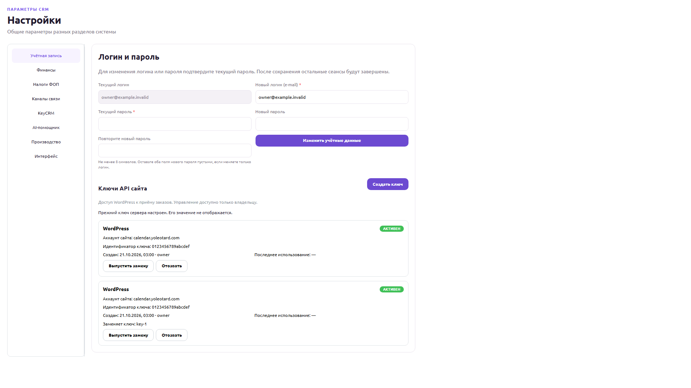
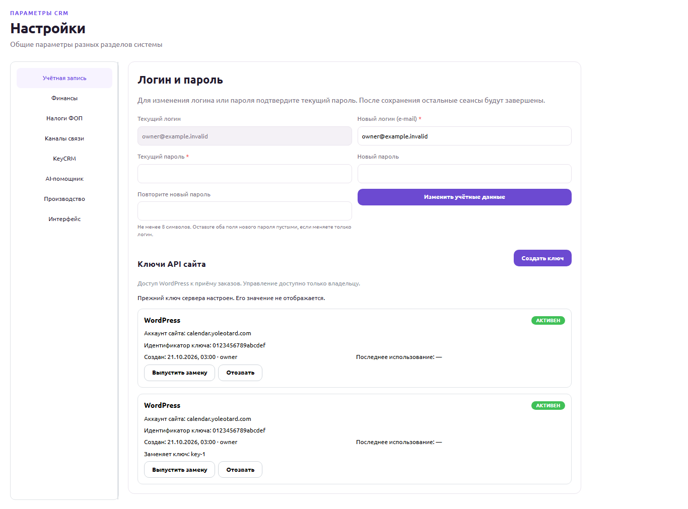
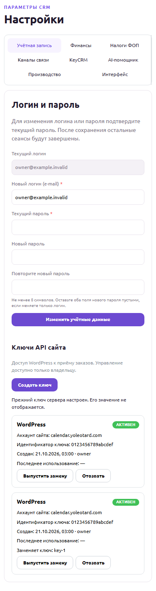

# Ключи API сайта — локальная реализация

Дата: 21 октября 2026. Ветка `codex/website-api-keys`, база
`cff6bd91a4033cd36524854068fdc93196c5295e`. Изменения подготовлены локально,
без коммита, push, развёртывания и доступа к рабочей базе или секретам.

## Что реализовано

- **Настройки → Учётная запись → Ключи API сайта** доступны владельцу.
  Создание, ротация и отзыв требуют текущий пароль и отдельное подтверждение.
- Секрет генерируется на сервере и показывается один раз; после закрытия,
  смены авторизации или ухода со страницы повторного показа нет. В базе —
  только версия хеша, хеш, публичный идентификатор и метаданные.
- Ротация создаёт второй действующий ключ. Старый отзывается отдельно после
  установки и проверки нового ключа в WordPress. История и аудит сохраняются.
- Ключ разрешает приём заказов только для `calendar.yoleotard.com`; не даёт
  доступа к учётной записи или остальным API CRM. Старый env-токен сохраняется.
- Настроены защита Origin/CSRF, лимиты по владельцу/IP, безопасные ошибки и
  условное обновление последнего использования раз в пять минут.

## База и совместимость

Аддитивная миграция `20261021090000_website_api_keys` создаёт одну таблицу
`WebsiteApiKey`, связи авторов/ротации, ограничения и защиту истории.
Старые 43 миграции сохранены. На отдельной локальной PostgreSQL18.4 применены
44 миграции, 72 таблицы; seed не выполнялся. Это не проверка миграции на рабочем
сервере PostgreSQL16 и не разрешение на её применение там.

Логика заказов, оплат, налогов, импорта KeyCRM, производства и доставки не
менялась. Авторизация выполняется до разбора JSON; серверная привязка источника
проверяется до существующей транзакции заказа. Согласованная цена и налоговый
учёт сохраняют прежние правила.

## Проверки

- 17 проверок настоящих Nest HTTP и PostgreSQL: сессии/OWNER, пароль, CSRF,
  отсутствие раскрытия в метаданных/аудите, параллельная ротация, отзыв,
  недопустимый источник, старый токен, сбои аудита с откатом, штатный заказ,
  оплата и неизменяемые налоговые записи при повторной отправке.
- 12 прежних PostgreSQL-проверок website API прошли отдельно.
- 24 целевых проверки API, 8 проверок состояния интерфейса и 45 проверок DAG.
- Браузер: 5 сценариев с настоящим SettingsWorkspace и Mantine на
  1920×1080, 1366×768, 390×844; отдельно один сценарий настоящего Next dev с
  оболочкой CRM и StrictMode. Проверены фокус, копирование, скрытие секрета,
  восстановление после неверного пароля и отсутствие горизонтального переполнения.
  API в браузерных сценариях подменён синтетическим стендом; настоящее API/БД
  проверены отдельными HTTP-тестами. Проверка WordPress и живой доставки не выполнялась.
- Полная проверка `pnpm quality:check`: **2319 PASS, 0 ошибок**, 13 явно
  обозначенных пропусков отдельно включаемых сценариев; новый PostgreSQL-набор
  выполнен в составе полного запуска. Проверка типов, сборки API и Next.js прошли.
  Все пять обязательных независимых ролей — PASS; итоговый статус
  **LOCAL_IMPLEMENTATION_ACCEPTED**, блокирующих замечаний нет. Дополнительные
  проверки стандартов и требований также пройдены; одно необязательное замечание
  о повторении загрузчика в тестах оставлено вне этой доработки.
- Независимый визуальный проверяющий дополнительно выполнил 11 браузерных
  сценариев и 4 проверки завершённых состояний ошибок/отзыва; замечаний,
  блокирующих локальную реализацию, нет. Сравнение выполнено с настоящим
  исходным SettingsWorkspace из базового коммита.

Первый полный запуск остановился на пяти прежних тестах, читавших изменяемый
PHP-файл соседнего проекта. Восстановлена точная исходная копия11 109 байт с
прежним SHA256 `381d1aa2dd3a7d3a92eb321ff8d7208a7c9ba711cf28ba9b027f7aeaafc339d3`.
Тест теперь читает закреплённую копию; ожидаемые payload, PHP harness и исходный
хеш не изменены. Все14 проверок этого набора проходят. Соседний проект не менялся.
Отсутствующий или повреждённый fixture вызывает ошибку, а не пропуск.

## Основные файлы

| Область | Файлы |
| --- | --- |
| Модель и SQL | `packages/database/prisma/schema.prisma`, `packages/database/prisma/migrations/20261021090000_website_api_keys/migration.sql` |
| OWNER API, хеширование и защита | `apps/api/src/website-api-keys/` |
| Совместимый приём заказов | `apps/api/src/website-orders/`, `apps/api/src/main.ts` |
| Настройки и однократное раскрытие | `apps/web/components/website-api-keys-panel.tsx`, `apps/web/components/settings-workspace.tsx`, `apps/web/lib/website-api-keys.ts`, `apps/web/lib/i18n.ts` |
| API и PostgreSQL-тесты | `apps/api/tests/website-api-keys-*.test.mjs`, `apps/api/tests/website-orders-key-ingress.test.mjs` |
| UI-тесты | `apps/web/tests/website-api-keys.test.mjs`, `apps/web/e2e/website-api-keys.spec.ts` |
| Воспроизводимый PHP-контракт | `apps/api/tests/website-checkout-plugin-contract.test.mjs`, `apps/api/tests/fixtures/checkout-v518-source.php` |

Коммитов после базового SHA не создано. Рабочий результат остаётся проверяемым
незакоммиченным diff в отдельном рабочем дереве. Полный перечень файлов и хешей
подготовлен для итоговой проверки; исходные рабочие деревья с другими изменениями
не сбрасывались и не объединялись.

## Скриншоты

Данные полностью синтетические. Здесь показаны только метаданные; изображения
однократного раскрытия секрета не публикуются.

## Инструкция и дальнейшие действия

Инструкция владельцу и порядок безопасной ротации:
[управление ключами](../integrations/website-api-key-management.md).
Архитектура и план будущего развёртывания/восстановления:
[план](../plans/website-api-keys.md), [ADR0011](../decisions/0011-website-api-key-lifecycle.md).

Развёртывание требует отдельного разрешения, резервной копии с проверкой
восстановления, миграции и проверки установленной версии. После перехода сайта
исключительно на ключи из базы нельзя откатывать API на несовместимый env-only
обработчик. Таблицу, ключи и аудит при откате не удалять.

Изолированная тестовая PostgreSQL и собственные браузерные стенды остановлены.
Данные и доказательства сохранены; рабочие сервисы не затрагивались.
